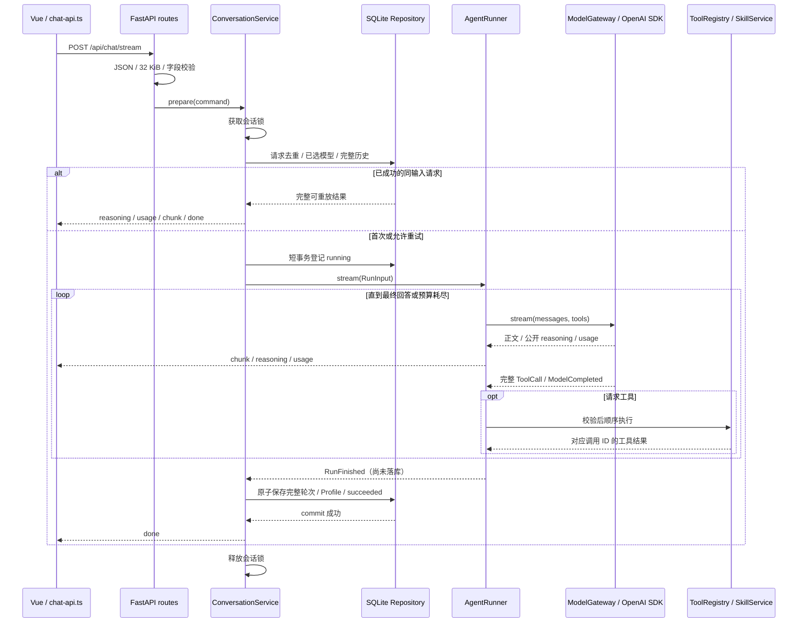

# 从页面到 Python Agent 的运行流程

页面通过 `/api/chat/stream` 发送消息；FastAPI 校验后交给 ConversationService。会话用例锁定当前 session、检查请求 ID、选择模型并加载历史，再交给 AgentRunner。Runner 驱动模型与 Skill Tool 循环。文字、公开推理和用量及时流向页面，完整结果落库成功后才发送 `done`。

生产构建页面由 Python 提供，页面和 API 同源。开发 Vite 的 5173 仍代理 3000；本批 Python 开发配置使用 3001，默认 TS 启动脚本暂不改变。

## 运行时序

## 按代码定位入口

所有 Python 路径相对于 `backend/src/dokkan_agent`。

| 位置                                                               | 可观察的内容                                                                         |
| ------------------------------------------------------------------ | ------------------------------------------------------------------------------------ |
| `main.py::main`                                                    | 进程入口，解析配置路径，单 worker 启动 Uvicorn                                       |
| `bootstrap/application.py::create_app`                             | 读取配置、创建 FastAPI；工厂本身不打开库                                             |
| `bootstrap/lifespan.py::create_lifespan`                           | 启动时发现 Skill、迁移指定 SQLite、恢复中断记录、建立 HTTPX 连接池；关闭时释放连接池 |
| `bootstrap/services.py::create_http_services`                      | 配置到应用对象/公开 Profile 的转换，避免生命周期混杂字段组装                         |
| `interfaces/http/routes.py::stream_chat`                           | 页面发起流请求后的首个业务断点                                                       |
| `interfaces/http/validation.py::read_chat_request`                 | 媒体类型、体积、camelCase DTO；转为领域 command                                      |
| `application/conversation/service.py::prepare`                     | 会话串行、重放、冲突、选择本轮模型，省略 Profile 时沿用会话选择                      |
| `application/conversation/service.py::PreparedConversation.stream` | 驱动内核并提交；成功结果只在 commit 后产生                                           |
| `application/runtime/runner.py::AgentRunner.stream`                | 每条消息独立上下文，模型/工具循环与运行预算                                          |
| `infrastructure/provider/openai_compatible.py::stream`             | 上游 HTTP，连接重试与取消                                                            |
| `infrastructure/provider/stream_decoder.py::CompletionDecoder`     | 工具片段归并；允许结束原因之后的 usage，不提前结束                                   |
| `infrastructure/memory/sqlite_repository.py::commit_reply`         | 两条消息、Profile、请求 succeeded 和完整响应同一事务                                 |
| `interfaces/http/routes.py::_stream_events`                        | 领域事件到 SSE；提交失败发 error，绝不补 done                                        |

非流接口 `/api/chat` 复用同一个内核与提交用例，只在完整提交后返回 JSON。历史接口返回原消息和元数据；构造模型上下文时才配对完整轮次，旧孤立记录不会被删除。

## 关键边界

- Skill 全局独立于模型。首次只给 Catalog，按需披露正文和单份资源，不读取开发辅助 `.codex/skills`。
- 网络调用不在 SQLite 事务内。同 session 排队，跨 session 并发；锁只保留活跃引用。
- 请求指纹包含正文和显式 profileId。成功跨重启重放；相同键不同输入冲突；正在等待的重复请求不自动接管失败执行。
- Provider 用官方 OpenAI SDK 的 `AsyncOpenAI` 访问 `baseUrl + /chat/completions`，复用显式配置的 HTTPX 连接池；SDK 负责请求构造、认证和上游错误处理；适配层通过 SDK 的原始流响应接口保留有界 SSE 校验、领域事件与工具片段归并。要求模型支持工具调用；公开 reasoning 透传，不生成隐藏思考过程。
- 收到 finish_reason 后继续读取尾部 usage。`[DONE]` 或带结束原因的干净 EOF 才结束调用；无结束原因、残缺 SSE 或工具 JSON 都失败。单次流限制 4 MiB，单事件 1 Mi 字符，每批最多 128 个工具片段索引，工具参数最多 64000 字符；执行预算还会进一步收紧。
- Provider 默认连接超时 10 秒、读取超时 60 秒、最多两次连接尝试。当前调用未输出领域事件时才重试网络/429/5xx；输出后失败不自动重新生成答案。
- 客户端断开向上游传播取消。准备完成但响应尚未接管、流未开始、流中断等路径都负责关闭租约；失败清理也无法写库时，下次启动收敛 running。
- 静态文件只来自 `web/dist`，真实路径不能逃逸；不存在的 `/api` 不回退成 HTML。普通响应与 SSE 复用安全头。

协议细节见 [HTTP 契约](http-contract.md)，事务和回退见 [存储契约](storage-contract.md)。启动与配置命令见 [后端 README](../README.md)。这批验证不使用真实模型密钥或领域数据服务，不能替代真实模型选 Skill 评估。
