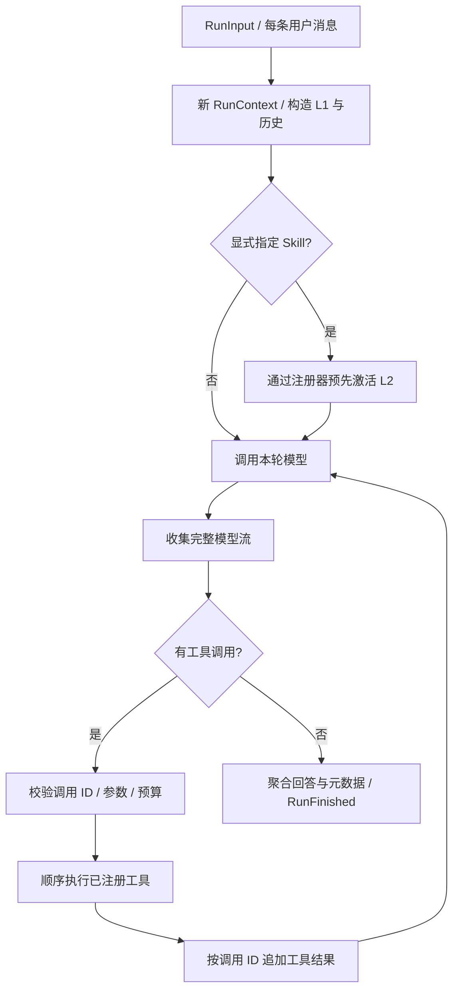

# Agent 内核运行流程

T03—T05 提供可独立运行的单 Agent 内核。正式 HTTP 入口仍停留在启动骨架；真实 Model Provider、ConversationService、SQLite 仓储在 T06—T08 接入。这个阶段不需要 Dokkan 数据服务。

## 主要入口和职责

| 入口 | 负责的内容 |
| --- | --- |
| `bootstrap/runtime.py::create_agent_runner` | 注入 ModelGateway 和 SkillCatalog，静态注册两个 Skill 工具 |
| `application/runtime/context_builder.py::ContextBuilder.build` | 基础提示、L1、完整历史、本轮用户消息及显式 Skill 激活 |
| `application/runtime/runner.py::AgentRunner.stream` | 驱动模型与工具循环，透传展示事件，成功时返回 RunFinished |
| `application/runtime/model_call.py::ModelCallCollector` | 完整性、结束原因、调用 ID、待执行工具数检查 |
| `application/runtime/aggregation.py::RunAggregation` | 汇总所有可见正文、公开推理和 Provider 用量 |
| `application/skill/service.py::SkillService` | 本轮激活、资源读取、去重与数量限制 |
| `application/tool/registry.py::ToolRegistry.execute` | JSON 和 Schema 校验、静态分发、输出验证、披露预算 |
| `infrastructure/skill/filesystem_catalog.py::FilesystemSkillCatalog.discover` | 显式目录发现、元数据和文件快照；不执行脚本 |

Runner 的输入包含本次 Profile 和完整历史轮次，不在内部解析配置或选择模型。这样同一 session 使用另一个模型时，历史和 Catalog 都可以继续复用。ConversationService 后续负责锁、去重和提交；Runner 不读写会话库，RunFinished 也不是 HTTP done。



## 三层披露

格式依据 [Agent Skills specification](https://agentskills.io/specification)。开发辅助 `.codex/skills`、用户 Skill 主目录都不会自动成为本产品的业务目录。

| 层级 | 进入模型的内容 | 进入时间 |
| --- | --- | --- |
| L1 | Skill name、description | 每条消息的首次模型请求 |
| L2 | 选中 Skill 正文、版本、资源清单 | `activate_skill(name)` 成功，或用户明确 `$skill-name` |
| L3 | 已激活 Skill 的单个 UTF-8 文本 | `read_skill_resource(name, relative_path)` 成功 |

磁盘发现为了构建版本快照会读取文件并计算哈希；“未加载”指正文未进入模型上下文，不代表磁盘没有读取。Catalog 不缓存全部 Skill 正文。每次披露核对快照和实际路径，变化时返回 SKILL_CHANGED，重启后重新发现，避免混用目录摘要和新正文。

显式 Skill 通过同一工具注册器执行，同样消耗工具次数、激活数量和完整 JSON 披露字符。重复名称按出现顺序去重。未知显式名称在模型调用前明确失败；普通 `$100` 货币表达式和 `$skill/path` 不被截取为文件路径或部分 Skill 名。

本轮重复激活和读取返回 already_active/already_loaded 标记，不再次返回正文。下一条用户消息创建全新 RunContext，只有之前的用户/助手历史继续存在；旧工具结果和指令不常驻。用户历史中曾写 `$skill-name` 不会触发当前轮激活。

## Skill 文件支持范围

`SKILL.md` 必须有 name、description；支持 license、compatibility、metadata 和 allowed-tools。名称与目录一致，长度 1—64，小写 Unicode 字母/数字与连字符，不允许首尾或连续连字符；描述最多 1024 字符。compatibility 最多 500 字符，metadata 为字符串键值。重复 YAML 键、对象构造标签、锚点/别名、未知顶层字段均拒绝，扩展信息放 metadata。

allowed-tools 只保留并记录兼容性提示，不控制工具权限，不创建任何工具。Profile 不包含 skillIds。

资源清单注册 `references/`、`assets/`、`scripts/` 中的文件。脚本和二进制文件只公开名称、版本和类型；当前可读取的文本后缀为 md、txt、json、yaml、yml、csv、xml、rst，且必须是 UTF-8。其他根目录文件不会成为资源入口；不支持通过 `../`、绝对路径、反斜杠、Windows drive/ADS 读取项目配置。

单文件部署硬上限为 1 MiB，每份 Skill 最多 256 个文件，YAML header 最多 16384 字符。目录 symlink/junction 拒绝，以避免递归环和目录别名；文件链接必须解析到该 Skill 根内。读取前后核对哈希，变化或外链不返回正文。不提供任意 Shell、文件读取或脚本执行工具。

## 工具定义和扩展

正式注册集合是 activate_skill、read_skill_resource。无副作用的 echo_text 示例在 `infrastructure/tool/echo_tool.py`，测试会单独加入注册表，正式 factory 不注册。新增工具可参考：

1. 用 `ToolParameters` 定义严格参数，禁止额外字段与自动类型转换。
2. 用 Pydantic 定义输出，用 async handler 调用应用用例。
3. 用 `FunctionTool` 包装，在组合根显式加入 `ToolRegistry`。

JSON 参数必须完整，禁止重复键、非有限数值，最多 32000 字符。参数无效返回 INVALID_ARGUMENTS，未知工具返回 UNKNOWN_TOOL；处理器异常和无效输出返回 EXECUTION_FAILED，原始异常不交给模型。预算耗尽直接结束运行，不能成为可无限修正的普通 Tool 错误。

工具执行前必须等 ModelCompleted 并确认整次流正常结束。工具调用 ID 本轮不能重复，一个批次顺序执行，允许同批先激活再读取资源。Provider 的 JSON 片段归并属于 T07；Runner 只接受完整的 ToolCallReady。

Dokkan 的 KnowledgeGateway 只定义候选查找与按需字段/章节读取，没有实现 HTTP Adapter，没有注册虚假的 Wiki 工具。以后取得真实服务协议再接入，当前不猜接口或鉴权。

## 上下文和预算

配置仍来自 JSON runtime，默认值：

| 项 | 上限 |
| --- | --- |
| 模型调用 | 12 次 |
| 工具执行 | 24 次，含未知/无效/重复请求及显式激活 |
| 唯一 Skill 激活 | 4 个 |
| 资源读取 | 8 次，含重复及失败读取 |
| 单份资源正文 | 16000 Unicode 字符；超限不返回半段 |
| 累计工具/指令披露 | 64000 字符，按实际 JSON 结果计数 |
| 模型上下文及整轮展示输出 | 各 128000 字符，配置项 maxContextCharacters |

上下文计数含消息、工具参数和 Schema 的 JSON 开销，是字符上限而非精确 Token 估算。历史窗口仍按消息条数，选择预算内最近的完整轮次；3 条最多带入 1 轮，不能带入半轮。原历史的 reasoning/usage 不作为模型提示注入。

同一次模型请求的多份累计 usage 取最后有效值；多个模型请求再求和。任一次调用缺少某项统计，则整轮该项未知；reasoningTokens 是子项，不额外计入 totalTokens。所有已展示的中间正文都进入成功回复，不只保存最后一次调用文字。公开 reasoning 独立汇总，不能编造隐藏思考过程。

调用方取消或关闭异步事件流时，会关闭正在进行的上游生成器。模型未正常结束、结束后又发事件、ID 重复或预算耗尽都不会产生 RunFinished。完整超时/重试与持久化失败处理留给 Provider 和 ConversationService。

## 无密钥演示与验证

在 backend 目录执行：

```powershell
uv sync --locked
uv run --locked python -X utf8 examples/progressive_skill_demo.py
uv run --locked pytest -q
```

演示使用明确标记的 ScriptedDemoModel，不连接真实模型、数据库或 Wiki。预期 3 次模型调用、2 次工具执行：首次无正文和资源，第二次仅正文，第三次仅增加选中的检查单；optional-format 资源始终没有进入上下文。

确定性用例验证协议和披露行为，不能证明真实模型选 Skill 准确率或 Dokkan 数值正确率。Windows 文件 symlink 用例因本机权限跳过；实际 directory junction 越界用例已执行，其他绝对/相对路径和部署变更用例也执行。
