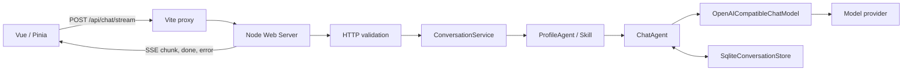

# 后端运行流程（历史归档：TypeScript）

> 以下内容是旧 TypeScript/Node 后端的历史运行链路，保留用于理解迁移前设计，不是当前启动或配置指南。旧根 `src/`、环境变量、Skill-as-Profile 和 Profile 不可切换等说明均不适用于当前 Python 服务；文中的 npm 命令也不能按旧语义执行。当前 `start/start:server` 启动 Python，`dev/web:dev` 同时启动 Python 与 Vite。请使用 [根 README](../README.md)、[Python 后端 README](../backend/README.md)、[当前 HTTP 运行流程](../backend/docs/http-runtime.md) 和 [服务端配置](configuration.md)。

## 1. 概述

Stargazer Agent 的运行链路由四部分组成：Vue 工作台、Node.js HTTP 服务、Agent 编排层和 SQLite 会话存储。模型调用使用 OpenAI 兼容的 `/chat/completions` 协议。

开发模式下，Vite 在 `5173` 提供 Vue 页面并将 `/api` 代理到 Node 服务的 `3000` 端口。生产模式下，Node 服务同时提供 `web/dist` 静态页面和 API。



## 2. 运行入口

### 2.1 前端

- HTML 入口：`web/index.html`
- Vue 入口：`web/src/main.ts`
- 根组件：`web/src/App.vue`
- 状态管理：`web/src/stores/chat.ts`
- HTTP/SSE 客户端：`web/src/services/chat-api.ts`

`npm run web:dev` 同时启动 Vite 和 Node：

```text
Vue page: http://127.0.0.1:5173
Node API: http://127.0.0.1:3000
```

### 2.2 后端

后端进程入口为 `src/server.ts` 的 `main()`。启动时执行以下步骤：

1. 读取模型、密钥、数据库路径和端口等环境变量。
2. 初始化 `SqliteConversationStore`。
3. 加载 `STARGAZER_AGENT_PROFILES` 中的 Profile。
4. 可选加载 `STARGAZER_SKILLS_DIR` 中各目录的 `SKILL.md`，并将它们转换为可选择的 Profile。
5. 创建 `ProfileAgent`、默认 `ChatAgent` 和 HTTP Server。
6. 监听 `HOST` 和 `PORT`，默认是 `127.0.0.1:3000`。

关键代码：

- `src/server.ts`: `main()`，负责运行时装配与 Fastify 启动
- `src/http/app.ts`: `createHttpApp()`，负责 HTTP 路由、SSE 和静态资源适配
- `src/skills/skill-loader.ts`: `loadAgentSkills()`，加载全局业务 Skill Catalog
- `src/memory/sqlite-conversation-store.ts`: `SqliteConversationStore.open()`

## 3. 前端发起请求

用户提交消息时，`useChatStore.sendMessage()` 执行以下流程：

1. 获取当前会话并清理用户输入的首尾空格。
2. 生成 `requestId`，并立即将用户消息加入本地会话和 localStorage。
3. 创建一条空的 assistant 消息，作为流式输出容器。
4. 调用 `requestAssistantResponse()`。
5. 默认调用 `streamChatMessage()`，向 `/api/chat/stream` 发送请求。
6. 每收到一个 SSE `chunk` 事件，即把文本追加到空 assistant 消息。
7. 成功后更新会话时间和本地持久化；失败后移除该 assistant 消息，并保留原用户消息以供重试。

请求体：

```json
{
  "sessionId": "session_xxx",
  "requestId": "request_xxx",
  "message": "用户输入",
  "profileId": "default"
}
```

`sessionId` 标识会话，`requestId` 标识一次用户发送。重试时复用原 `requestId`，后端可据此去重。

## 4. HTTP API 层

`src/http/app.ts` 的 `registerApiRoutes()` 负责路由。

| 路径               | 方法     | 用途                             |
| ------------------ | -------- | -------------------------------- |
| `/api/status`      | `GET`    | 查询服务状态、模型和默认 Profile |
| `/api/profiles`    | `GET`    | 查询可选模型 Profile             |
| `/api/history`     | `GET`    | 读取服务端会话历史               |
| `/api/history`     | `DELETE` | 删除服务端会话                   |
| `/api/chat`        | `POST`   | 非流式问答                       |
| `/api/chat/stream` | `POST`   | SSE 流式问答                     |

聊天请求在进入 Agent 前，会由 `src/http/request-validation.ts` 完成以下校验：

- `Content-Type` 必须是 `application/json`。
- 请求体最大 32 KiB。
- `sessionId`、`requestId`、`profileId` 只能包含字母、数字、下划线和连字符。
- 消息不能为空，最大长度为 16,000 字符。

校验失败会直接返回结构化 HTTP 错误，避免非法输入到达模型、SQLite 或业务 Agent。

## 5. 会话编排与并发控制

`src/application/conversation-service.ts` 的 `ConversationService` 负责请求幂等和同会话串行：

1. 使用 `sessionId + requestId` 生成请求键。
2. 相同请求已完成时，返回缓存回答，不再次调用模型。
3. 相同请求正在执行时，等待已有 Promise。
4. 同一 `sessionId` 的不同请求经 `runQueued()` 串行执行。
5. 同一 `requestId` 携带不同消息时，返回 `409 REQUEST_CONFLICT`。

这保证了后发送的消息不会抢在前一条回答持久化之前读取旧上下文。

对于流式请求，`ConversationService.stream()` 将 Agent 输出的每个文本块交给 HTTP 层；`sendStream()` 将其转为 SSE：

```text
event: chunk
data: {"content":"部分回复"}
```

正常结束发送 `done`，错误发送 `error`。前端解析逻辑位于 `web/src/services/chat-api.ts`。

## 6. Profile、Skill 与 ChatAgent

`ProfileAgent` 在首次发言时确定当前会话的 Profile：

1. 从 `conversation_sessions.profile_id` 读取已绑定的 Profile。
2. 新会话优先使用请求的 `profileId`，否则使用默认 Profile。
3. 将 Profile 写入 SQLite。
4. 已绑定的会话请求其他 Profile 时，拒绝并返回 `PROFILE_CONFLICT`。

Skill 是一种由 `SKILL.md` 加载出来的 Profile。它提供业务系统提示、可选模型和历史窗口，不会自行获得文件、命令或网络权限。

`ChatAgent` 的单轮处理如下：

1. 创建当前用户消息。
2. 从会话存储读取历史，按 Profile 的 `historyLimit` 截断。
3. 组装 `systemPrompt + history + current user message`。
4. 调用模型 Provider。
5. 模型正常结束后，作为一个完整轮次写入用户消息和 assistant 消息。

## 7. 模型调用与 Tool

`OpenAICompatibleChatModel` 负责把内部消息转成 OpenAI 兼容请求，并调用：

```text
{OPENAI_BASE_URL}/chat/completions
```

流式模式解析上游 SSE 的 `choices[0].delta.content`。网络错误、超时、非成功 HTTP 状态和异常响应结构会转换为脱敏后的模型错误，不会将 API Key 或上游响应正文返回给浏览器。

`ChatAgent` 支持 `ToolRegistry`。只有服务端显式注册的工具可以被模型请求，且每轮有调用次数上限。工具调用中间消息只用于当前模型上下文；会话历史只保存用户消息和最终回答。目前 Web 启动流程默认不注册 Tool。

## 8. SQLite 持久化语义

`SqliteConversationStore` 使用两个主要表：

- `conversation_sessions`：保存 `session_id`、`profile_id` 和时间戳。
- `conversation_messages`：以递增 `sequence` 保存 `user` 和 `assistant` 消息。

写入一个对话轮次时，存储层使用 SQLite 事务：先创建或更新会话，再插入全部消息，最后提交。模型失败、流中断或写库失败时会回滚，服务端不会保留半轮记录。

因此，浏览器可能已经显示部分流式文本，但如果随后收到 `error`，该不完整回答不会进入服务端历史。

## 9. 错误边界

| 层级          | 典型错误                    | 对外行为                               |
| ------------- | --------------------------- | -------------------------------------- |
| HTTP 校验     | 非 JSON、字段非法、请求过大 | `4xx` 和稳定错误码                     |
| 会话编排      | requestId 冲突、会话忙      | `409`                                  |
| Profile       | Profile 不存在或切换冲突    | `400` 或 `409`                         |
| SQLite        | 数据库不可用、事务失败      | `503 CONVERSATION_STORAGE_UNAVAILABLE` |
| 模型 Provider | 网络、超时、上游异常        | `502 MODEL_UNAVAILABLE` 或 SSE `error` |

前端收到失败后保留用户消息和原 `requestId`。用户点击重试时可安全复用该请求标识；若后端已经完成但响应丢失，会直接返回缓存答案。

## 10. 调试断点建议

前端断点：

- `web/src/stores/chat.ts`: `sendMessage()`、`requestAssistantResponse()`
- `web/src/services/chat-api.ts`: `streamChatMessage()`

后端断点：

- `src/server.ts`: `main()`
- `src/http/app.ts`: `registerApiRoutes()`、`sendStream()`
- `src/application/conversation-service.ts`: `stream()`、`runQueued()`
- `src/profiles/profile-agent.ts`: `chatStream()`
- `src/chat/agent.ts`: `chatStream()`、`buildRequest()`
- `src/providers/openai-compatible.ts`: `requestCompletion()`
- `src/memory/sqlite-conversation-store.ts`: `append()`
